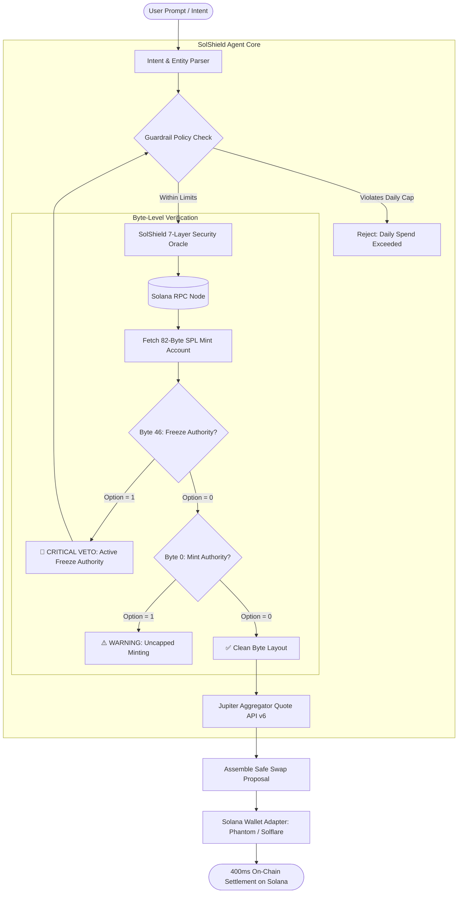

# 🛡️ SolShield AI — Autonomous Solana DeFi Guardian & Trading Agent

> **Built for the [MLH Solana Hackathon 2026](https://events.mlh.io/events/15200-solana-hackathon)**  
> *Targeting: **AI Track Top Prize**, **DeFi Track Top Prize**, and **Top 3 Overall ($1,000 Microgrant)***

[](https://solana.com)
[](https://jup.ag)
[](LICENSE)

---

## 📌 Executive Summary & Problem

In 2026, autonomous AI agents are executing trading strategies, managing on-chain liquidity, and swapping tokens on Solana. However, AI agents suffer from a critical flaw: **they cannot distinguish a legitimate token from a rug pull before committing capital**.

Scam tokens don't look dangerous in basic metadata scrapers. Instead, the exploits live in the **raw 82-byte on-chain binary structure** of the SPL Token Mint account:
1. **Active Freeze Authority:** The creator can freeze holder token accounts instantly, preventing anyone from selling.
2. **Uncapped Mint Authority:** The creator can mint trillions of additional tokens and dump them directly into liquidity pools.
3. **Runaway Agent Spending:** LLM hallucinations or flawed trading loops can deplete an entire wallet balance in seconds without deterministic constraints.

**SolShield AI** solves this by inserting a **pre-trade byte deserialization oracle** and **deterministic spend guardrails** between the AI agent's intent parser and the on-chain execution layer.

---

## 🏗️ System Architecture



---

## ✨ Core Innovations & Features

### 1. Direct 82-Byte SPL Mint Deserializer
SolShield inspects the raw binary memory layout of Solana's SPL Token Mint account:
* **Bytes 0–35:** Mint Authority Option & 32-byte public key.
* **Bytes 36–45:** Raw little-endian u64 token supply and u8 decimals.
* **Bytes 46–81:** Freeze Authority Option & 32-byte public key.

If Byte 46 equals `1`, the creator retains the right to freeze any holder's wallet. SolShield halts execution immediately.

### 2. Autonomous Intent-Based Trading Assistant
Users simply type natural language intents:
* *"Analyze BONK token"* — Triggers live 7-layer oracle audit.
* *"Swap 0.2 SOL to USDC"* — Verifies token health, queries Jupiter routes, and prepares one-click transaction signing.
* *"Swap 0.5 SOL for Honeypot Moon"* — Triggers live guardrail interception to showcase automated rug protection!

### 3. Deterministic Session Guardrails
* **Max Spend per Trade:** Hard cap per transaction (e.g., 0.5 SOL).
* **24-Hour Daily Allowance:** Budget gauge that prevents bot runaway loops.
* **Minimum Safety Threshold:** Configurable risk score floor (default: 75/100).

### 4. Interactive Portfolio Risk Radar
Aggregates all tokens in the user's wallet and computes a weighted **Portfolio Health Index**, highlighting any malicious airdrops with active freeze authorities.

---

## ⚡ Tech Stack

* **Frontend:** Next.js 14 (App Router), Tailwind CSS, Lucide Icons
* **Blockchain:** `@solana/web3.js`, `@solana/spl-token`, `@solana/wallet-adapter-react`
* **DEX Routing:** Jupiter Aggregator API (`v6/quote`)
* **Agent Architecture:** Model Context Protocol (MCP) Tool Integration, TypeScript Engine

---

## 🚀 Quickstart & Local Setup

```bash
# 1. Clone repository
git clone https://github.com/<your-username>/solshield-ai.git
cd solshield-ai

# 2. Install dependencies
npm install

# 3. Start local development server
npm run dev
```

Open [http://localhost:3000](http://localhost:3000) in your browser.

---

## 🎯 Hackathon Tracks Addressed

1. **AI Track:** Autonomous natural language agent with step-by-step reasoning traces and proactive security auditing.
2. **DeFi Track:** Integration with Jupiter DEX Aggregator for lowest-slippage routes and SPL token verification.
3. **Top 3 Overall ($1,000 Microgrant):** Ready-to-scale infrastructure solving the single biggest vulnerability facing web3 autonomous agents today.
